## Fase 1: Anàlisi i justificació (document d'informe)
Heu de redactar un informe que justifiqui tècnicament la decisió de la Direcció i compareu les opcions. Aquest informe ha d'incloure:

1. Introducció i justificació:

- Explicació de per què les contrasenyes febles o reutilitzades són un risc crític per a l'empresa (atac de diccionari, credential stuffing, etc.).

**Tenir contrasenyes febles o reutilitzades és un risc, perquè si són reutilitzades, el primer que fan és provar aquesta contrasenya en tots els llocs on tu estàs registrat. Però si les contrasenyes són febles, el problema és que en un atac que li fan al servidor, poden treure la teva contrasenya d'una manera molt ràpida i fàcil, ja que no és complicada. En un atac de diccionari, si la contrasenya és feble, tarda segons a ser crackejada; i si a això hi afegim que la utilitzes per a tots els llocs, ja poden entrar on ells vulguin.**

- La funció crucial d'un gestor de contrasenyes per mitigar aquests riscos.

**Un gestor de contrasenyes és una eina que serveix per guardar i crear contrasenyes de manera segura, ja que normalment solen ser molt estranyes. És molt útil perquè permet tenir una contrasenya diferent per a cada compte sense haver de memoritzar-les totes.**

2. Comparativa tècnica: realitzeu una taula comparativa detallada entre:
- **Bitwarden (alternativa online / núvol): analitzeu la sincronització, el model de seguretat (xifratge end-to-end), la facilitat d'accés des de múltiples dispositius i el cost/model freemium.**

- **KeePassX / KeePassXC (alternativa offline / escriptori): analitzeu l'emmagatzematge local de l'arxiu (KDBX), la independència del núvol, el model open source i la portabilitat de l'arxiu.**

# Comparativa tècnica: Bitwarden vs KeePassXC

| Característica | Bitwarden (núvol) | KeePassXC (local) |
|---|---|---|
| Sincronització | Automàtica entre dispositius. | Manual o amb serveis externs. |
| Seguretat | Xifratge d'extrem a extrem. | Base de dades xifrada amb AES-256 o altres algoritmes compatibles. |
| Accés | Ordinadors, mòbils i navegadors. | Cal disposar del fitxer de contrasenyes i de l'aplicació compatible. |
| Emmagatzematge | Núvol amb dades xifrades. | Fitxer local `.kdbx`. |
| Dependència del núvol | Sí, per a la sincronització habitual. | No, funciona sense Internet. |
| Codi obert | Sí. | Sí. |
| Cost | Versió gratuïta i plans de pagament. | Gratuït. |
| Portabilitat | Accés des de diferents dispositius amb el mateix compte. | El fitxer es pot copiar a un USB o transferir a altres dispositius. |
| Avantatge principal | Comoditat i sincronització automàtica. | Control local de les dades. |
| Inconvenient principal | Depèn del servei al núvol. | Cal gestionar les còpies de seguretat i la sincronització. |

3. Avantatges i inconvenients: resumiu els principals pros i contres de cada model (online vs. offline) des del punt de vista de seguretat, usabilitat i continuïtat del negoci.

### Bitwarden (online / núvol)

**Avantatges:**
- Sincronitza les contrasenyes automàticament entre dispositius.
- Utilitza xifratge d'extrem a extrem per protegir les dades.
- És fàcil d'utilitzar i permet accedir a les contrasenyes des de qualsevol lloc amb Internet.
- Facilita la continuïtat del negoci si un dispositiu es perd o es canvia.

**Inconvenients:**
- Depèn del servei al núvol per sincronitzar les dades.
- Cal protegir bé el compte principal.
- Algunes funcions són de pagament.

### KeePassXC (offline / local)

**Avantatges:**
- Les contrasenyes es guarden localment i no depenen del núvol.
- Permet tenir més control sobre les dades.
- És gratuït i de codi obert.
- Es pot utilitzar sense connexió a Internet.

**Inconvenients:**
- La sincronització entre dispositius és més complicada.
- Si es perd o es fa malbé el fitxer sense tenir una còpia de seguretat, es poden perdre totes les contrasenyes.
- Requereix més gestió manual i pot ser menys còmode per treballar en equip.

4. Recomanació: concloeu l'informe escollint l'eina que considereu més adequada per al personal tècnic de l'empresa i justifiqueu la vostra elecció.

**La meva recomanació és utilitzar Bitwarden, ja que és una eina fàcil d'utilitzar i permet sincronitzar les contrasenyes entre diferents dispositius. A més, utilitza xifratge d'extrem a extrem i permet compartir credencials de manera controlada amb les funcions adequades.**

## Fase 2: Guia d'ús tècnica (manual operatiu)
Utilitzant l'eina que heu seleccionat a la Fase 1 (Bitwarden, KeePassX o similar), heu de crear una guia d'ús per a l'Equip Tècnic. Aquesta guia ha de ser clara i basada en captures de pantalla i instruccions pas a pas.

La guia ha de cobrir els següents punts obligatoris:

1. Instal·lació i configuració inicial: descàrrega, instal·lació i creació de la BBDD principal o compte mestre.

- Busquem l'aplicació Bitwarden.

- Per a que ja estem dins de la web.
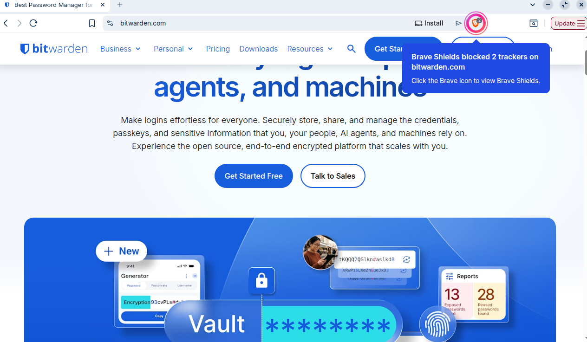

- Aquí es descarrega l'aplicació.
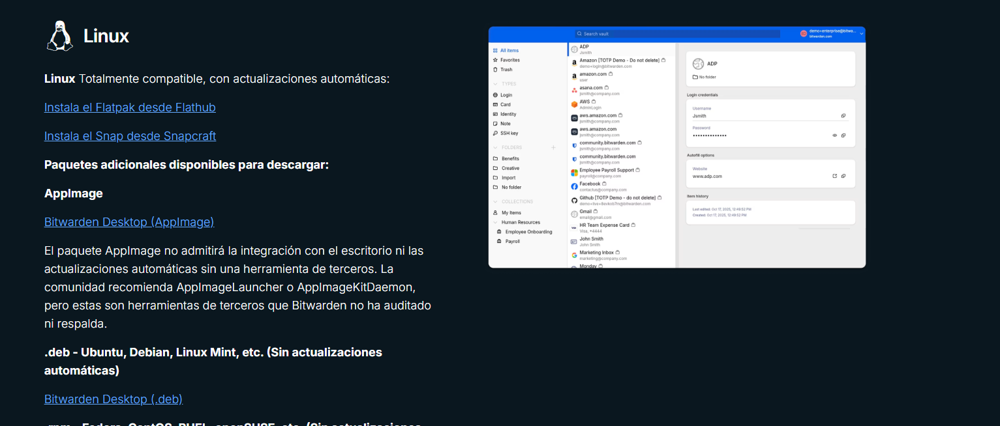

- Aquí posem on volem que es descarregui.

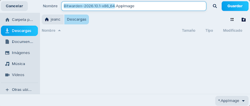

- Procés d'instal·lació del programa al sistema.
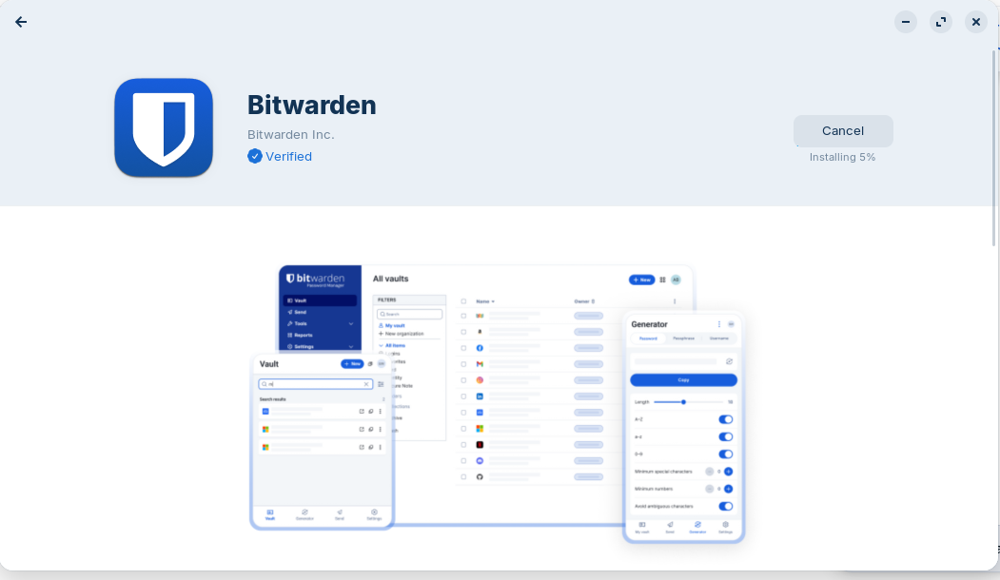

- Una vegada l'aplicació descarregada, l'obrim.
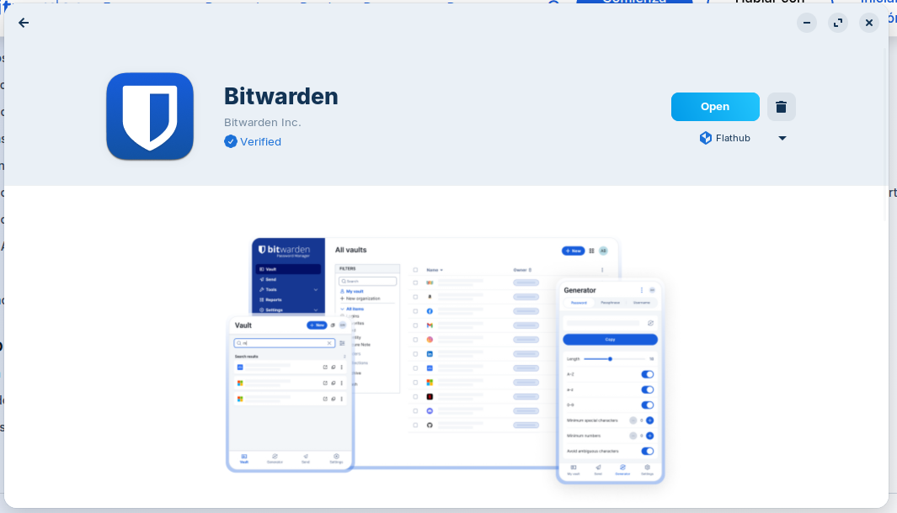

- L'aplicació ja està oberta i preparada per iniciar la configuració inicial; si no tens compte, li dones a crear compte.

- Pantalla de creació del compte mestre de Bitwarden.

- Una vegada ja has fet el compte, t'arriba un correu.
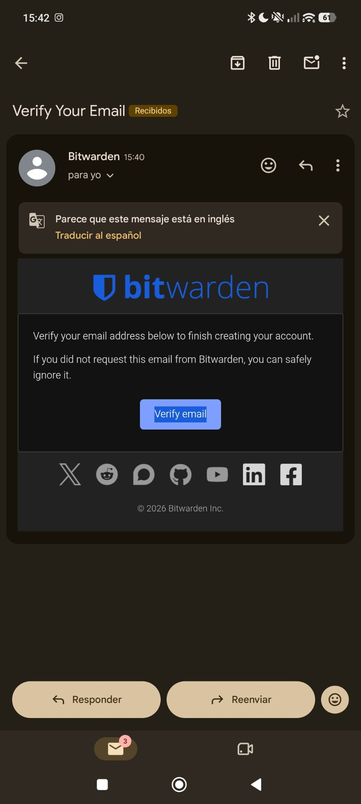

- Introducció de la contrasenya del compte; ha de ser segura i tenir com a mínim 12 caràcters.
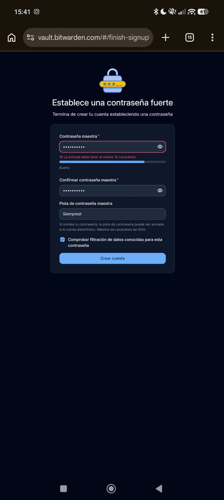

- Inici de sessió al compte de Bitwarden després del registre.
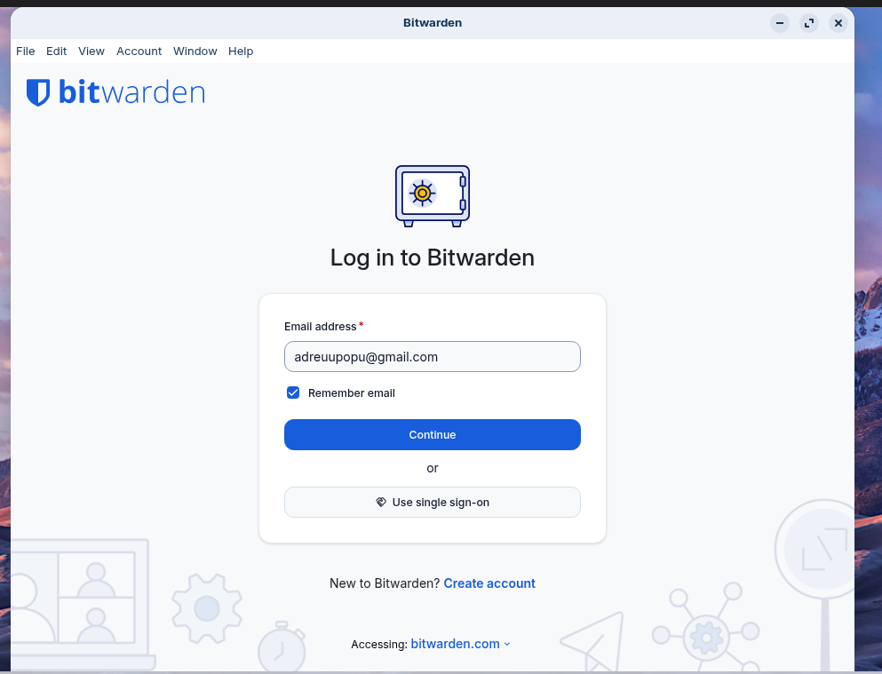

- Ara posem la contrasenya per iniciar sessió.
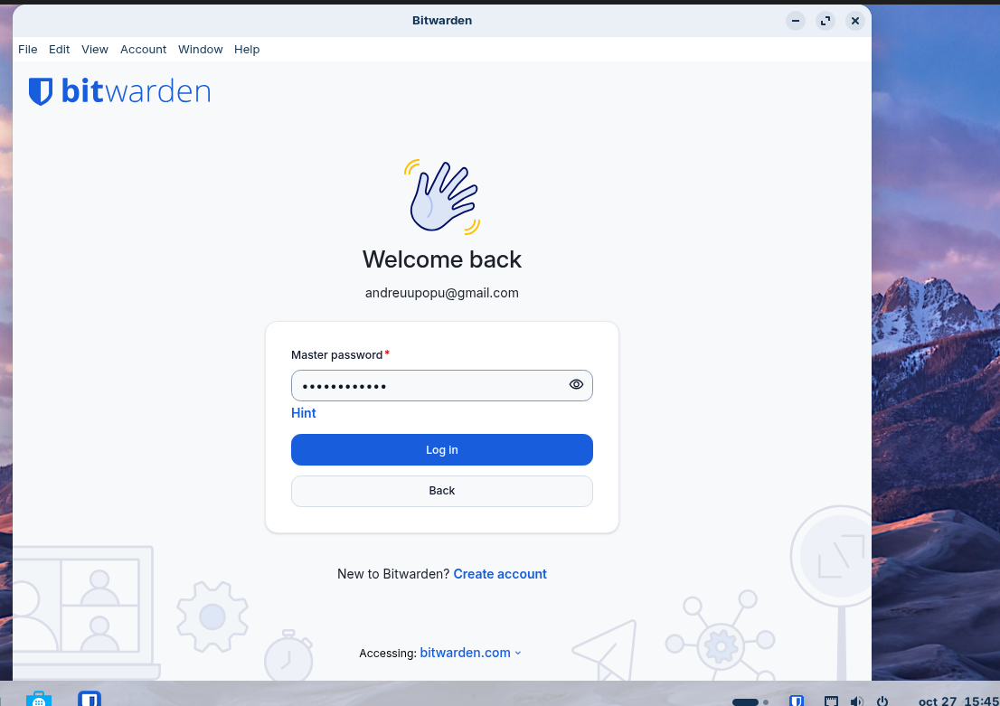

2. Generació de contrasenyes segures: explicació de com utilitzar el generador de contrasenyes de l'eina (paràmetres, longitud, caràcters especials).

- Generador de contrasenyes de Bitwarden, on es pot configurar la longitud, la complexitat i els caràcters especials perquè la contrasenya sigui segura i difícil de forçar.

3. Exemples d'ús i emplenament automàtic:

- Prova del funcionament del gestor de contrasenyes amb un exemple: poses el nom del que guardes i es genera la contrasenya; una vegada ja està feta, li donem a «Save».
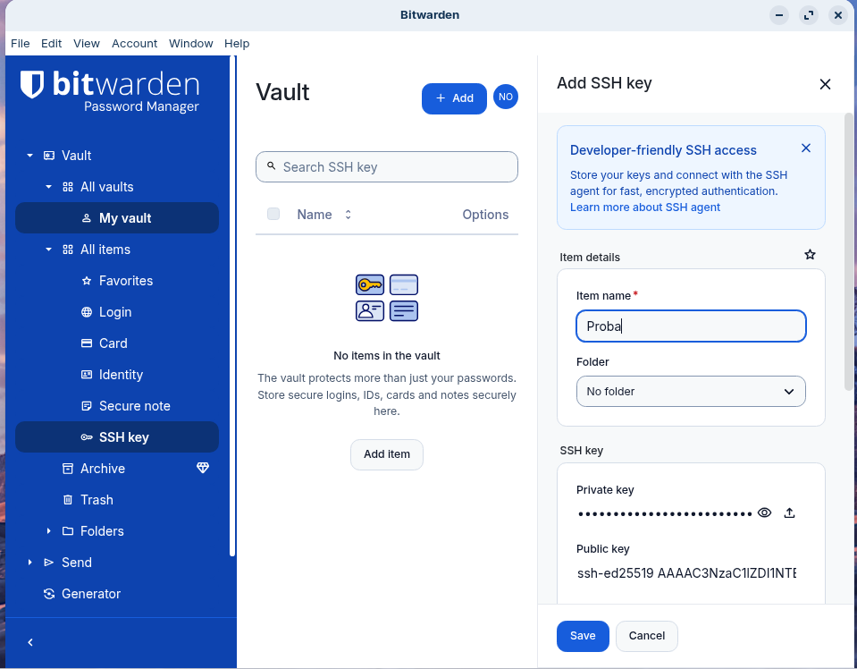

- Exemple d'una contrasenya de compte guardada per a un lloc web: posem el nom de la web, el nom d'usuari i després li donem al botó del cosat (o de la clau) en l'apartat de contrasenya; es genera la contrasenya depenent del que nosaltres volem.

- Visualització de la contrasenya generada i emmagatzemada per a una pàgina web; també podem posar una authenticator key, per si perdem l'accés o el token, i l'enllaç a la web.

- Extensió de Bitwarden integrada al navegador per omplir credencials de manera automàtica.
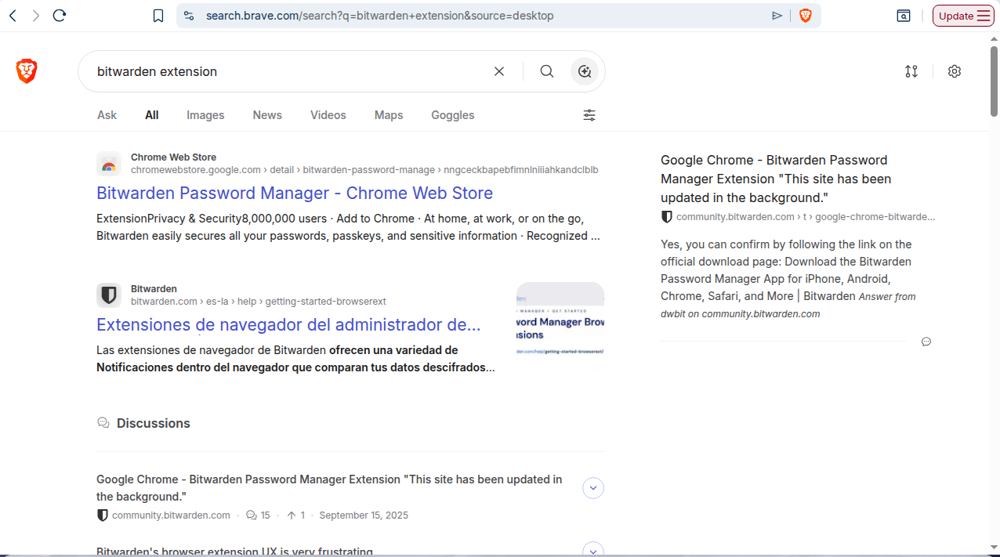

- Procés per afegir la extensió del navegador.

- Configuració de la extensió perquè s'integri correctament amb el navegador i el compte.

- Inici de sessió des de la extensió de Bitwarden.

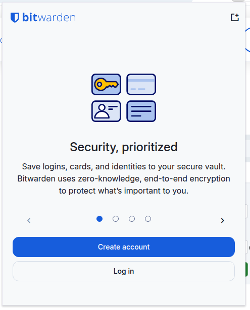

- Introducció del correu electrònic dins de la extensió per autenticar-se.

- Introducció de la contrasenya del compte des de la extensió.

- Comprovació final que l'emplenament automàtic i l'autenticació funcionen correctament.

4. Gestió de còpies de seguretat (backup):

- Opció d'exportació de les dades del gestor de contrasenyes per crear una còpia de seguretat.

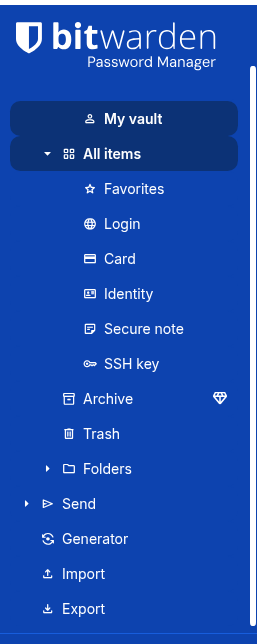

- Pantalla de l'exportació del fitxer de còpia de seguretat.

- Confirmació del procés d'exportació o backup abans de guardar-ho.

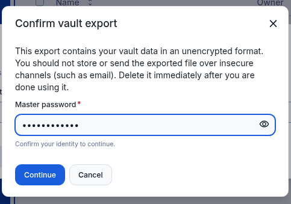

- Elecció de la ubicació on es guardarà la còpia de seguretat.

### Recomanació
Per guardar aquest arxiu on hi ha totes les contrasenyes, ho podeu guardar en un disc dur extern o en un USB xifrat.
