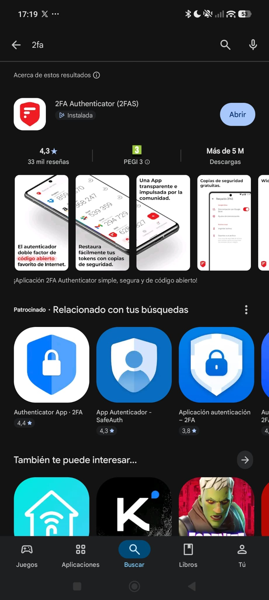
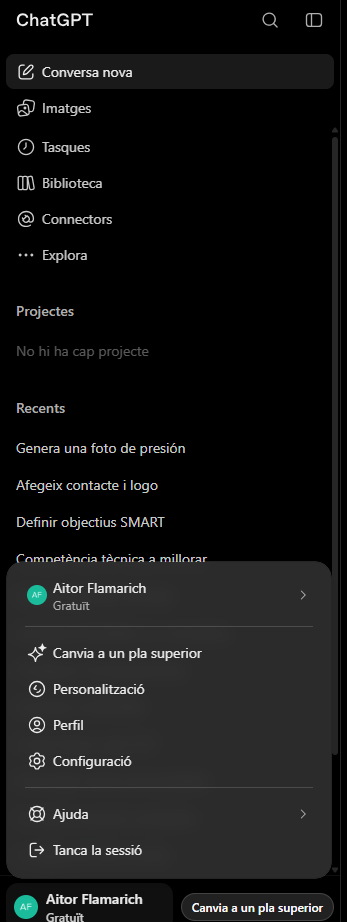
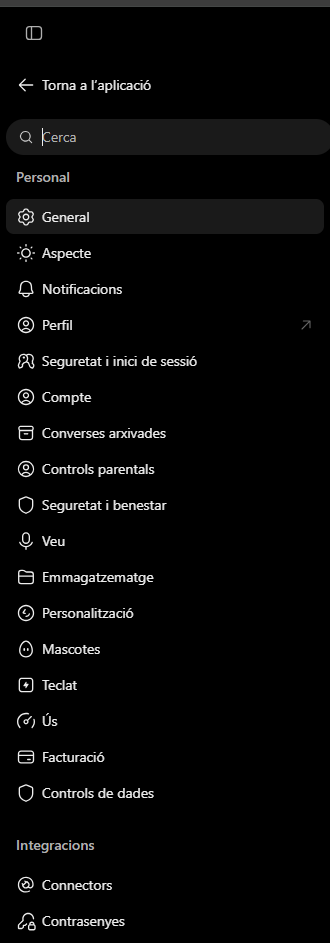
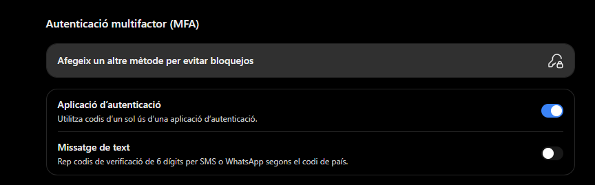
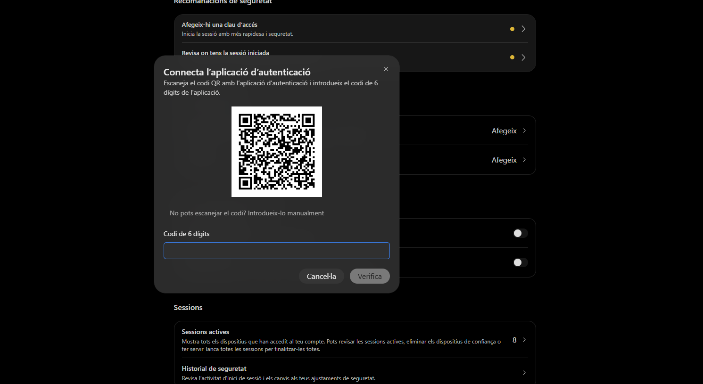
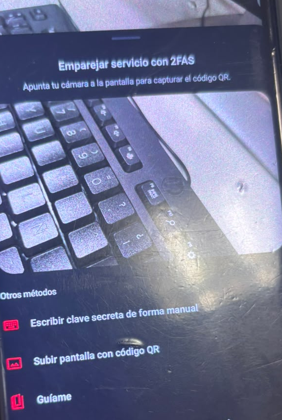

## Guia de com utilitzar una aplicació de autenticació multifactor (MFA)

L'autenticació multifactor afegeix una segona comprovació per verificar la teva identitat. En lloc de confiar només en la contrasenya, l'aplicació genera codis temporals que s'han d'introduir quan entrem als comptes sensibles.

### 1. Buscar la aplicació d'autenticació

Busquem la aplicació 2FA a la botiga d'aplicacions i la descarreguem.

### 2. Instal·lar l'aplicació

Quan la tenim descarregada, la instal·lem al telèfon; la tenim que connectar la aplicació amb el lloc o amb el que volem protegir. En aquest cas he utilitzat ChatGPT; entrem a la configuració.

### 3. Configuració

Una vegada a la configuració, tenim que buscar un lloc que digui "Seguretat i inici de sessió".

### 4. Obrir l'aplicació i connectar-la al compte

Una vegada a la configuració, tenim que buscar un lloc que digui "Aplicació d'autenticació".

### 5. QR

Una vegada ens surt un codi QR, per això hem d'obrir l'aplicació i, un cop oberta, li donem al més de la dreta i escanegem el codi.

### 6. Escanejar el QR

Una vegada li donem al +, surt l'opció per escanejar el QR.

### 7. Codi del servei

Una vegada escanejat, li surt un codi; aquest codi és el que demanarà cada vegada que iniciïs sessió. El codi canvia cada 30 segons, i els segons que queden surten a la dreta. A dalt del número surt el correu on està vinculat el compte del servei que has posat.

## 8. Introduir codi

El codi que surt l'hem de posar on posa "Codi de 6 dígits".

### Conclusió
L'objectiu del MFA és que, encara que algú conegui la contrasenya, no pugui accedir al compte sense el segon factor. L'aplicació de codis temporals és una de les formes més segures i útils de protegir la nostra informació diàriament.

